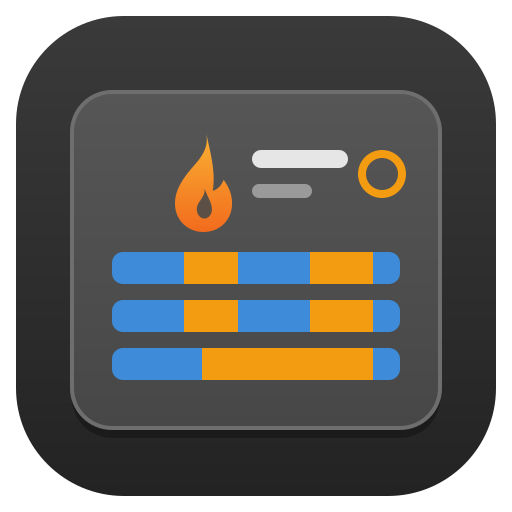
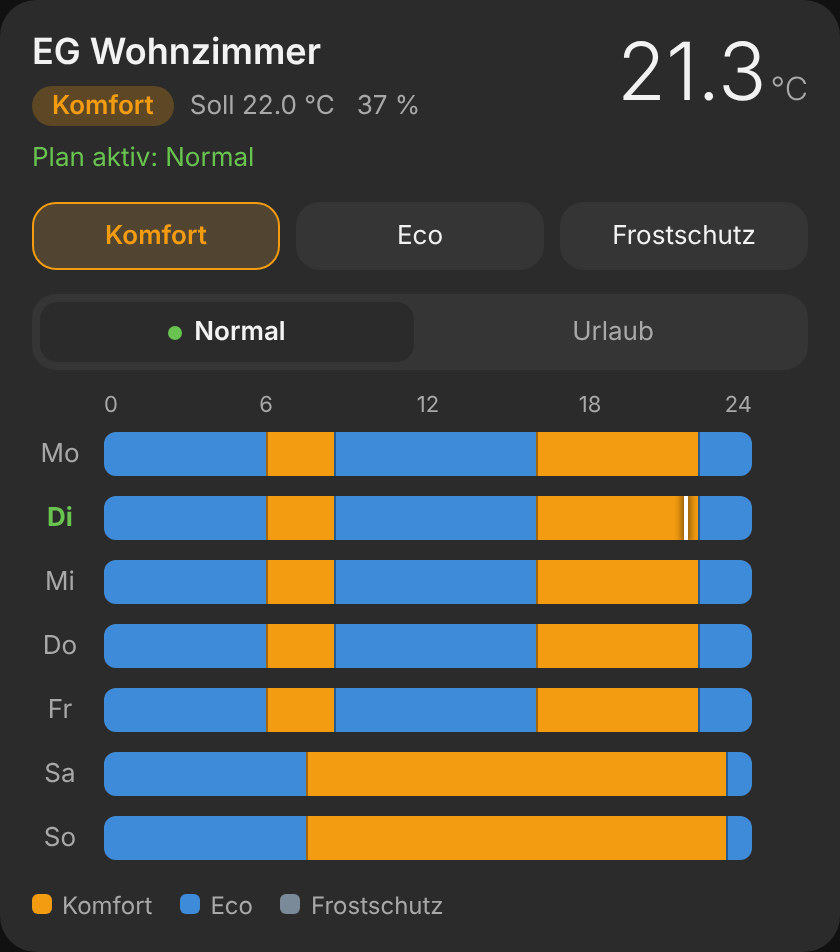
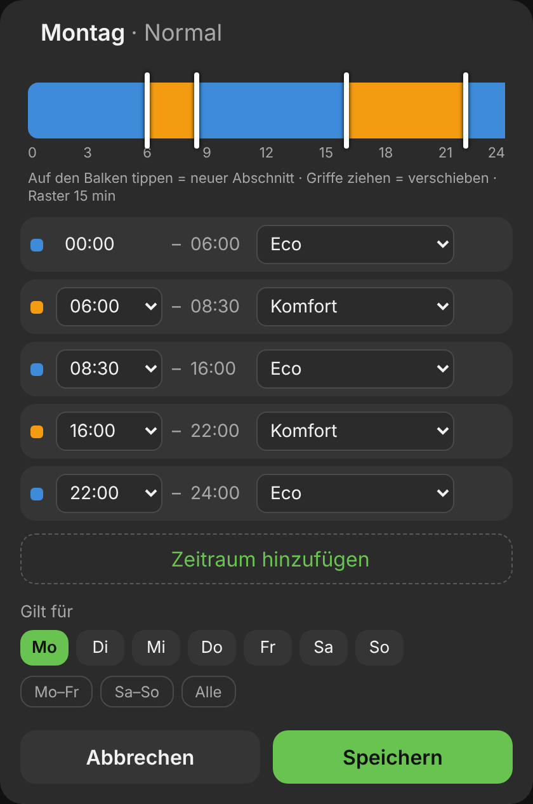
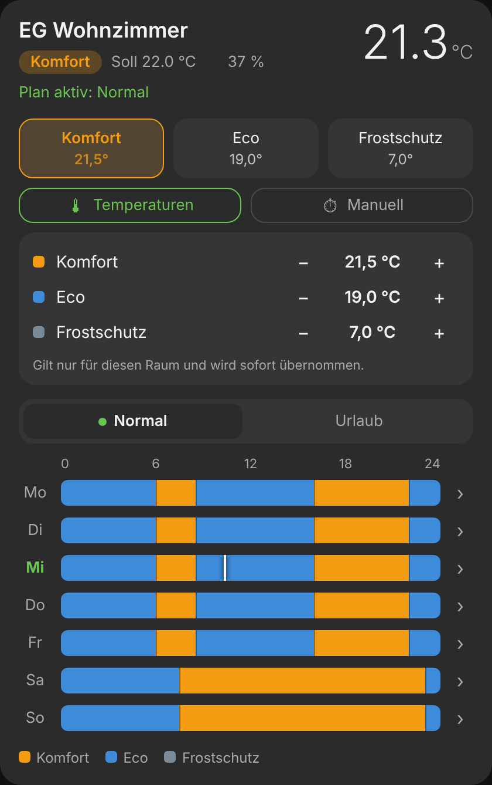
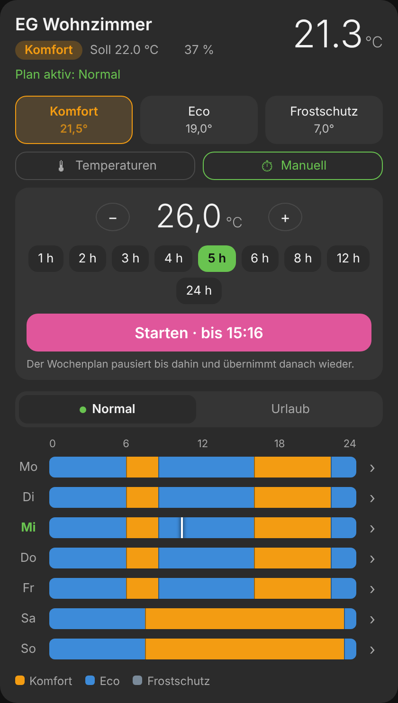
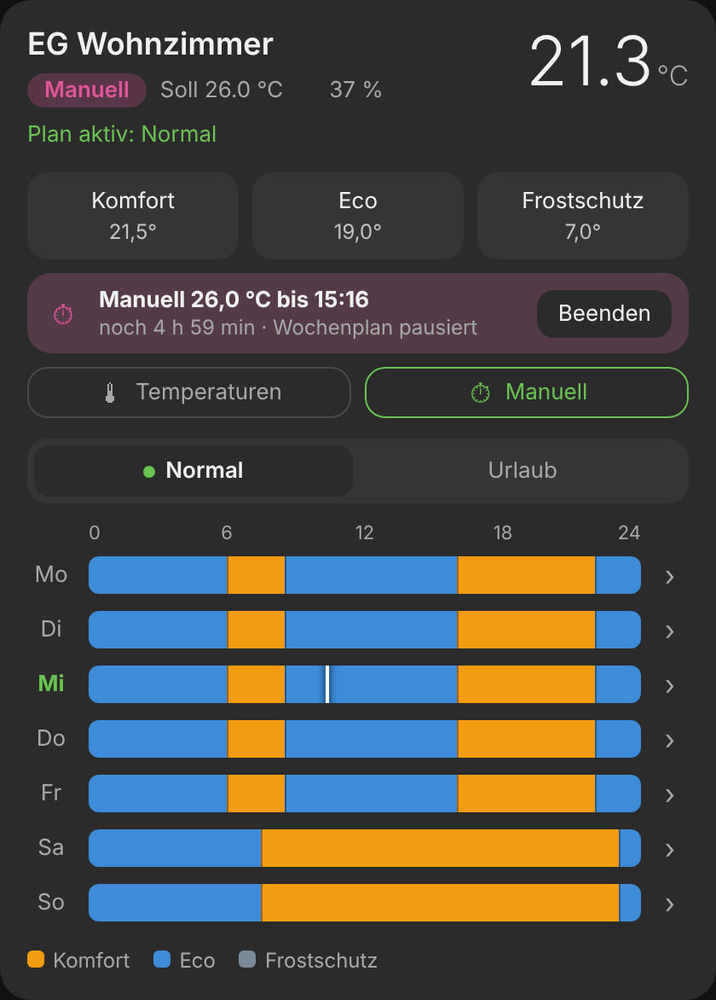
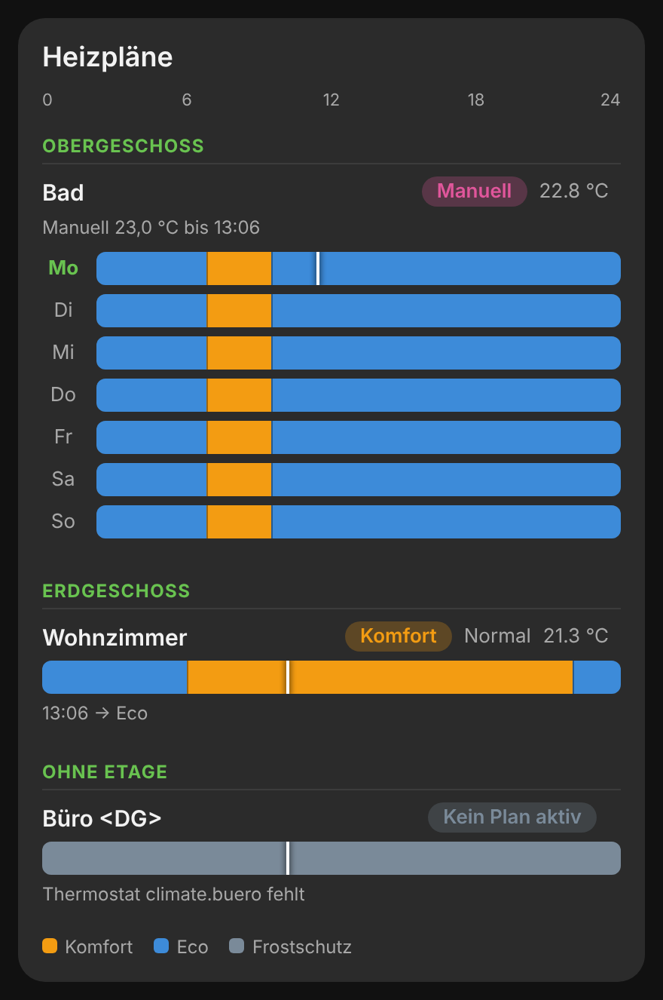
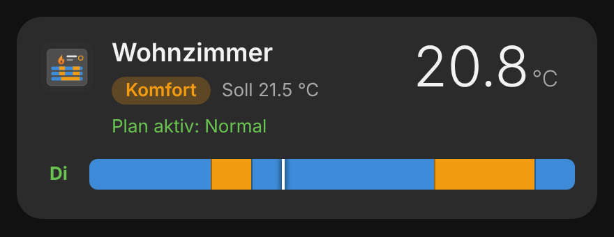

# Heizplan Card

Wochenplan pro Raum für Home Assistant: Komfort, Eco und Frostschutz als farbige Zeitleiste, Tageseditor zum Ziehen, eigene Pläne für Normal und Urlaub. Die Pläne liegen in der Integration [Heizplan](https://github.com/juergenschorb/heizplan), ein Plan je Raum, und laufen im Hintergrund weiter, auch wenn kein Dashboard offen ist.

| Wochenansicht | Tageseditor |
| --- | --- |
|  |  |

| Temperaturen je Raum | Manuell auf Zeit | Manuell aktiv |
| --- | --- | --- |
|  |  |  |

## Funktionen

- Wochenansicht Mo–So mit Markierung „jetzt“
- Kopf mit Ist- und Solltemperatur, aktivem Modus, Ventilöffnung und Fensterstatus
- Knöpfe zum sofortigen Umschalten (Komfort / Eco / Frostschutz)
- Tageseditor: auf den Balken tippen fügt einen Abschnitt ein, Griffe ziehen verschiebt (15-min-Raster), Modus pro Abschnitt, auf andere Tage übernehmen (Mo–Fr, Sa–So, Alle)
- Normal- und Urlaubs- bzw. Abwesend-Plan als Reiter; welcher Plan gilt, entscheidet die Integration (Heizperiode, Heizmodus, Anwesenheit)
- **Temperaturen je Raum**: Komfort/Eco/Frostschutz-Temperatur pro Raum mit − / + einstellen
- **Feiertag**: an Feiertagen und bei „Urlaub zuhause“ gilt Mo–Fr der Plan vom Sonntag
- **Manuell auf Zeit**: z. B. 26 °C für 5 Stunden; der Wochenplan pausiert so lange und übernimmt danach wieder
- Kompakte Ansicht, Übersicht aller Räume, komplett per GUI konfigurierbar

## Voraussetzungen

- Integration [Heizplan](https://github.com/juergenschorb/heizplan) ab Version 0.4.0 (Marketplace), je Raum ein Eintrag unter *Einstellungen → Geräte & Dienste → Heizplan*
- Ein Raumthermostat (`climate.…`) mit Presets, z. B. [Versatile Thermostat](https://github.com/jmcollin78/versatile_thermostat) (`comfort`, `eco`, `frost`) oder [Better Thermostat](https://github.com/KartoffelToby/better_thermostat) ab 1.9 (`comfort`, `eco`, `away`)

## Installation

### Über den Marketplace (früher HACS)

Seit Home Assistant 2026.11 ist HACS als „Marketplace“ eingebaut. Ein vorhandenes HACS wird beim Update automatisch übernommen.

1. *Einstellungen → Marketplace* → **Add from link** (eigenes Repository per Link hinzufügen)
2. URL `https://github.com/juergenschorb/claude-homeassistant` eintragen
3. „Heizplan Card“ installieren; Updates erscheinen danach unter *Einstellungen → Updates*
4. Browser neu laden (Companion App: App schließen und neu öffnen)

### Manuell

1. `dist/heizplan-card.js` nach `/config/www/heizplan-card.js` kopieren
2. *Einstellungen → Dashboards → ⋮ → Ressourcen → Ressource hinzufügen*: URL `/local/heizplan-card.js?v=0.14.0`, Typ **JavaScript-Modul**
3. Bei neuen Versionen Datei ersetzen und `?v=` hochzählen

## Karte einrichten

Dashboard bearbeiten → *Karte hinzufügen* → **Heizplan Card**. Alles lässt sich im Karten-Editor auswählen:

| Feld | Bedeutung |
| --- | --- |
| Raumthermostat oder Heizplan-Raum | der Raum (`sensor.heizplan_<raum>`) oder das Thermostat des Raums (Pflicht). Mit dem Raum bleibt die Karte beim Tausch des Thermostats unverändert |
| Name | Anzeigename auf der Karte, sonst Raumname |
| Kompakte Ansicht | nur Kopfzeile und heutiger Tag, Antippen klappt auf |
| Raumtemperatur | eigener Temperatursensor (optional) |
| Fensterkontakt | zeigt „Fenster offen“ (optional) |
| Ventilstellung | `number` oder `sensor` in %, nur Anzeige (optional) |
| Temperatur Komfort / Eco / Frostschutz | `number` je Preset (optional, sonst automatisch gefunden) |

Thermostat, Heizperiode, Heizmodus, Anwesenheit und Feiertage stellst du beim Raum in der Integration ein (*Einstellungen → Geräte & Dienste → Heizplan → Konfigurieren*), nicht in der Karte. Gibt es für das Thermostat noch keinen Raum, weist die Karte darauf hin.

Beispiel in YAML:

```yaml
type: custom:heizplan-card
entity: sensor.heizplan_wohnzimmer
name: Wohnzimmer
window_entity: binary_sensor.wohnzimmer_fenster
valve_entity: number.wohnzimmer_ventil
```

Erweitert (nur YAML): eigene Modi/Farben mit `modes:` (`key`, `label`, `color`, optional `preset`).

## Feiertage

An Feiertagen (Mo–Fr) und bei „Urlaub zuhause“ gilt der Plan vom Sonntag. Den Feiertagskalender (Integration **Feiertage**, `calendar.…`) oder einen Arbeitstag-Sensor (**Workday**) trägst du beim Raum in der Integration ein. Die Karte zeigt an solchen Tagen einen Hinweis und markiert den Sonntag als heute.

## Temperaturen je Raum

Knopf **Temperaturen** zeigt die Temperatur je Modus für diesen Raum; − / + ändert sie sofort. Die Karte schreibt in die Preset-Entitäten von Versatile Thermostat (`number.<raum>_preset_comfort_temp`, `…_eco_temp`, `…_frost_temp`) und findet sie über das Gerät des Thermostats selbst.

**Better Thermostat** (ab 1.9) legt für jedes aktivierte Preset ebenfalls eine Temperatur-Entität an (z. B. „Komfort“, „Eco“, „Abwesend“); die Karte findet sie genauso. Better Thermostat hat kein Frostschutz-Preset, deshalb nutzt die Karte dort automatisch „Abwesend“ (`away`) für Frostschutz. Die Presets Komfort, Eco und Abwesend müssen in der Better-Thermostat-Konfiguration aktiviert sein.

Bei Versatile Thermostat gilt: Damit es diese Entitäten pro Raum gibt, muss im Versatile Thermostat des Raums **„Zentrale Konfiguration für Presets verwenden“ aus** sein. Sonst zeigt die Karte die Werte nur an. Bei anderen Thermostaten lassen sich eigene `number`/`input_number` im Karten-Editor unter „Preset-Temperaturen“ wählen.

## Manuell auf Zeit

Knopf **Manuell** → Temperatur mit − / + wählen, Dauer antippen (1–24 h) → **Starten**:

1. Das Thermostat bekommt die gewählte Temperatur (`climate.set_temperature`).
2. Die Integration pausiert den Wochenplan dieses Raums bis zum Ende und schaltet dann wieder nach Plan.

Das läuft in der Integration, auch ohne offenes Dashboard und über einen Neustart hinweg. **Beenden** oder ein Modus-Knopf beendet die Vorgabe sofort.

In Versatile Thermostat sollte „Dauer manueller Übersteuerung“ (`manual_override_duration_min`) auf 0 stehen, sonst setzt VT die Temperatur schon vorher zurück. Das Feld gibt es erst nach Version 10.5.1; ältere Versionen setzen ohnehin nichts zurück.

## Zusammenspiel mit der Integration

Die Karte speichert nichts selbst, alles liegt in der Integration [Heizplan](https://github.com/juergenschorb/heizplan) auf dem Home-Assistant-Server.

- Räume legst du in der Integration an (*Einstellungen → Geräte & Dienste → Heizplan → Raum hinzufügen*). Eine Übernahme aus dem Scheduler gibt es nicht mehr; vorhandene Pläne trägst du in der Karte neu ein.
- Ab Integration 0.3.0 kann je Raum eine Anwesenheit (Modus der Etage) gewählt werden: „Abwesend“ schaltet auf den zweiten Plan, „Urlaub zuhause“ nutzt Mo–Fr den Plan vom Sonntag.
- Als Entität der Karte kann das Thermostat oder der Raum (`sensor.heizplan_<raum>`) stehen.

## Übersicht aller Räume (ab 0.7.0)

Die Datei bringt eine zweite Karte mit: **Heizplan Übersicht** (`custom:heizplan-overview-card`). Sie zeigt alle Räume der Heizplan-Integration mit Modus, aktivem Plan, Raumtemperatur, nächstem Wechsel und dem heutigen Tag als Balken. Ein Tipp auf einen Raum klappt die ganze Woche auf. Bearbeitet wird in der Heizplan Card des Raums.



```yaml
type: custom:heizplan-overview-card
title: Heizpläne
```

Die Räume werden nach Etage gruppiert, wenn die Thermostate in Home Assistant einem Bereich mit Etage zugeordnet sind (abschaltbar mit `group_by_floor: false`). So können Räume in verschiedenen Etagen gleich heißen, z. B. zweimal „Wohnzimmer“. Den Raumnamen vergibst du beim Übernehmen in der Karte oder später unter *Geräte & Dienste → Heizplan → ⋮ → Umbenennen*.

Ab 0.10.1 wählst du im Karteneditor unter „Angezeigte Etagen“ (`floors:`), welche Etagen die Übersicht zeigt, z. B. nur DG oder EG + DG. Leer heißt alle. Die Karte zeigt dann nur noch die Räume dieser Etagen. Wer in der Karte selbst umschalten möchte, schaltet mit `floor_filter: true` zusätzlich Schaltflächen je Etage ein.

Ab 0.12.0 gibt es für die Raumkarte die **kompakte Ansicht** (`compact: true` oder im Karteneditor „Kompakte Ansicht“): Die Karte zeigt nur die Kopfzeile (Modus, Soll, aktiver Plan, Raumtemperatur) und den Plan des heutigen Tages. Antippen klappt sie mit Temperaturen, Manuell und Mo–So auf, ein Tipp auf die Kopfzeile klappt sie wieder zu.



Ab 0.9.0 zeigen beide Karten oben links das Heizplan-Symbol. Mit `show_icon: false` (oder im Karteneditor „Symbol anzeigen“) blendest du es aus.

Optional nur bestimmte Räume:

```yaml
type: custom:heizplan-overview-card
title: Heizpläne OG
rooms:
  - sensor.heizplan_bad
  - sensor.heizplan_buero
```

Tippst du in der Übersicht auf einen Raum, öffnet sich dessen Heizplan-Karte in einem Fenster (Bearbeiten, Manuell usw. wie in der Raumkarte). Schließen mit ✕, Tippen daneben oder Esc. Der Pfeil rechts klappt stattdessen die Woche in der Übersicht auf. Mit `tap_action: expand` klappt auch das Antippen des Raums nur die Woche auf (ab 0.15.0).

## Stand

Version 0.14.0, benötigt Integration 0.4.0. Mit Testdaten im Browser geprüft, noch nicht in einer echten Home-Assistant-Instanz.
