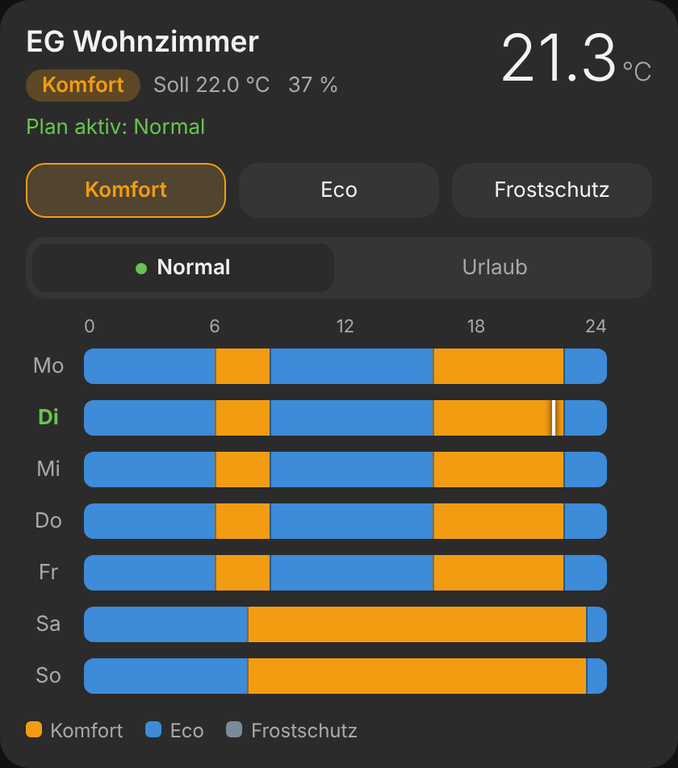
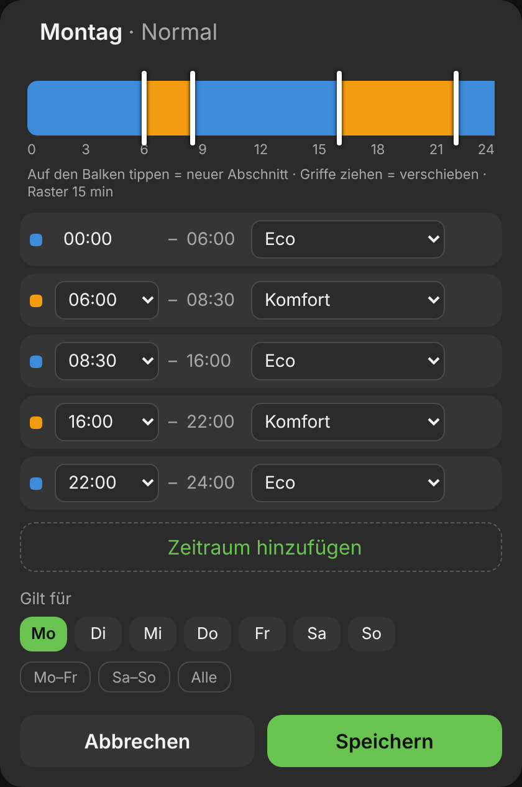
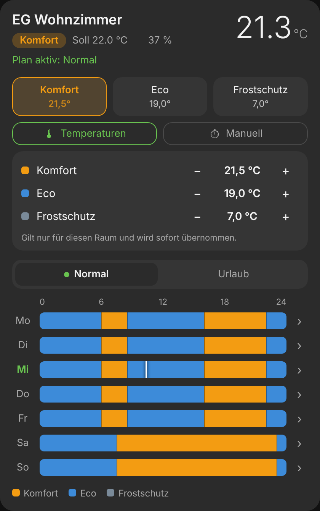
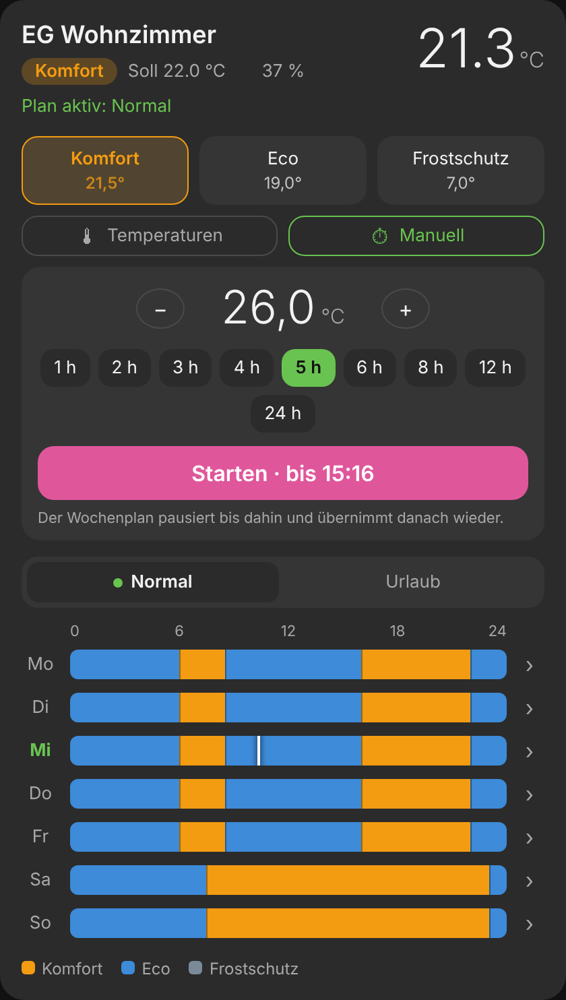
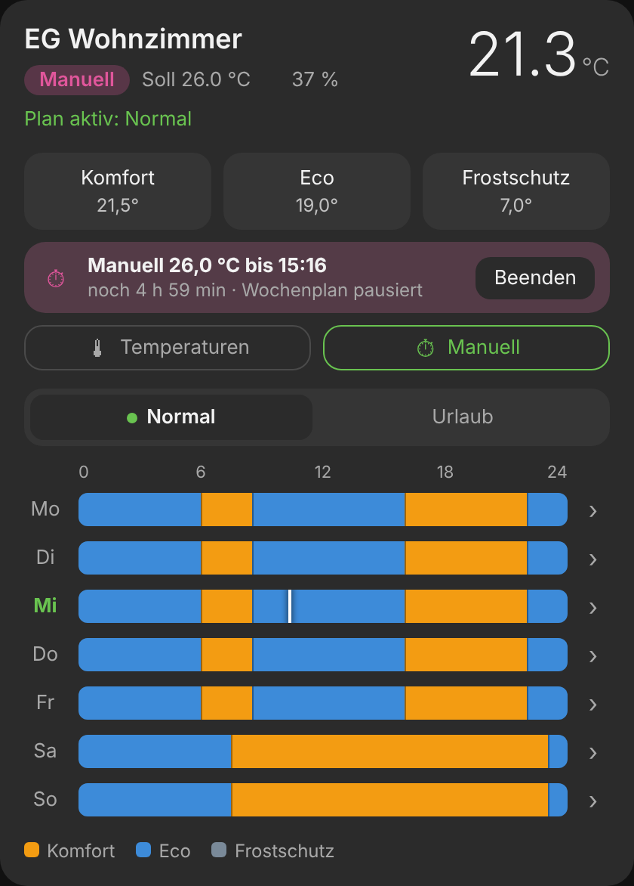
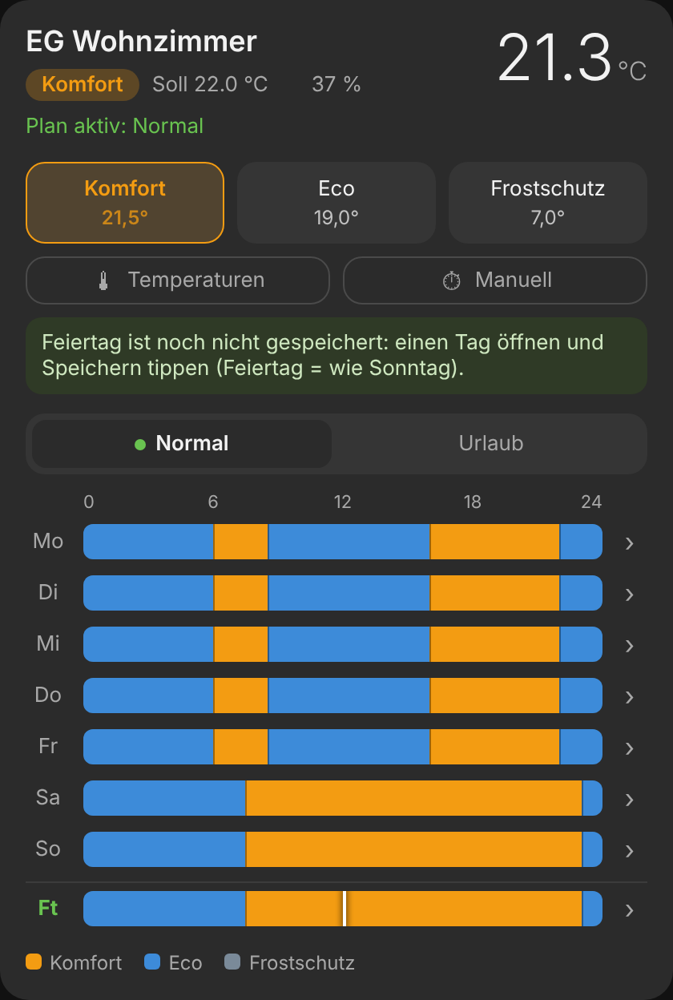

# Heizplan Card

Wochenplan pro Raum für Home Assistant: Komfort, Eco und Frostschutz als farbige Zeitleiste, Tageseditor zum Ziehen, eigene Pläne für Normal und Urlaub. Die Pläne laufen über die [Scheduler-Komponente](https://github.com/nielsfaber/scheduler-component) im Hintergrund weiter, auch wenn kein Dashboard offen ist.

| Wochenansicht | Tageseditor |
| --- | --- |
|  |  |

| Temperaturen je Raum | Manuell auf Zeit | Manuell aktiv |
| --- | --- | --- |
|  |  |  |

## Funktionen

- Wochenansicht Mo–So mit Markierung „jetzt“
- Kopf mit Ist- und Solltemperatur, aktivem Modus, Ventilöffnung und Fensterstatus
- Knöpfe zum sofortigen Umschalten (Komfort / Eco / Frostschutz)
- Tageseditor: auf den Balken tippen fügt einen Abschnitt ein, Griffe ziehen verschiebt (15-min-Raster), Modus pro Abschnitt, auf andere Tage übernehmen (Mo–Fr, Sa–So, Alle)
- Normal- und Urlaubsplan als Reiter; jeder Plan läuft nur, wenn Heizperiode und Heizmodus passen
- **Temperaturen je Raum**: Komfort/Eco/Frostschutz-Temperatur pro Raum mit − / + einstellen
- **Feiertag**: eigene Zeile „Ft“, heizt anfangs wie Sonntag und lässt sich wie jeder Tag bearbeiten
- **Manuell auf Zeit**: z. B. 26 °C für 5 Stunden; der Wochenplan pausiert so lange und übernimmt danach wieder
- Komplett per GUI konfigurierbar

Dazu zwei Blueprints:

- **Heizung – Vorheizen mit Lernfunktion**: heizt so früh vor, dass die Komforttemperatur zum geplanten Zeitpunkt erreicht ist, lernt die Aufheizrate je Raum und berücksichtigt die Außentemperatur
- **Heizung – Aus / außerhalb der Heizperiode**: schaltet die Raumthermostate bei Heizmodus „Aus“ oder außerhalb der Heizperiode aus

## Voraussetzungen

- [Scheduler-Komponente](https://github.com/nielsfaber/scheduler-component) (HACS, Integration)
- Ein Raumthermostat (`climate.…`) mit Presets, z. B. [Versatile Thermostat](https://github.com/jmcollin78/versatile_thermostat) (`comfort`, `eco`, `frost`) oder [Better Thermostat](https://github.com/KartoffelToby/better_thermostat) ab 1.9 (`comfort`, `eco`, `away`)

## Installation

### Über HACS

1. HACS → ⋮ → **Benutzerdefinierte Repositories**
2. URL `https://github.com/juergenschorb/claude-homeassistant`, Typ **Dashboard** → Hinzufügen
3. „Heizplan Card“ suchen → Herunterladen
4. Browser neu laden (Companion App: App schließen und neu öffnen)

### Manuell

1. `dist/heizplan-card.js` nach `/config/www/heizplan-card.js` kopieren
2. *Einstellungen → Dashboards → ⋮ → Ressourcen → Ressource hinzufügen*: URL `/local/heizplan-card.js?v=0.5.1`, Typ **JavaScript-Modul**
3. Bei neuen Versionen Datei ersetzen und `?v=` hochzählen

## Karte einrichten

Dashboard bearbeiten → *Karte hinzufügen* → **Heizplan Card**. Alles lässt sich im Karten-Editor auswählen:

| Feld | Bedeutung |
| --- | --- |
| Raumthermostat | `climate`-Entität des Raums (Pflicht) |
| Name | Anzeigename, sonst Name des Thermostats |
| Raumtemperatur | eigener Temperatursensor (optional) |
| Fensterkontakt | zeigt „Fenster offen“ (optional) |
| Ventilstellung | `number` oder `sensor` in % (optional) |
| Grundmodus | Modus für Tage ohne Plan (Standard Eco) |
| Heizperiode | Schalter (`input_boolean`, `binary_sensor`, `switch`); Pläne laufen nur, wenn er an ist |
| Heizmodus | zentrale Auswahl (`input_select`/`select`), z. B. Aus / Heizen / Urlaub |
| Feiertage | optional: Feiertagskalender (`calendar.…`, z. B. Integration „Feiertage“/Holiday) oder Arbeitstag-Sensor (Workday). Schaltet die Zeile „Feiertag“ ein |
| Option „Heizen“ | Optionstext, bei dem der Normal-Plan läuft |
| Option „Urlaub“ | Optionstext, bei dem der Urlaubsplan läuft (leer = kein Urlaubsplan) |

| Temperatur Komfort / Eco / Frostschutz | `number` je Preset (optional, sonst automatisch gefunden) |

Stimmt ein Optionstext nicht mit der Auswahl überein, zeigt die Karte einen Hinweis mit den vorhandenen Optionen.

Die Karte **liest** Heizperiode und Heizmodus nur. Umgeschaltet wird zentral, z. B. über einen Kalender oder ein eigenes Dashboard-Element. Die Reiter „Normal“ / „Urlaub“ wählen nur, welcher Plan angezeigt und bearbeitet wird; der grüne Punkt zeigt, welcher gerade gilt.

Beispiel in YAML:

```yaml
type: custom:heizplan-card
entity: climate.wohnzimmer
name: Wohnzimmer
window_entity: binary_sensor.wohnzimmer_fenster
valve_entity: number.wohnzimmer_ventil
season_entity: input_boolean.heizperiode
mode_entity: input_select.heizmodus
mode_heat: Heizen
mode_vacation: Urlaub
```

Erweitert (nur YAML): eigene Modi/Farben mit `modes:` (`key`, `label`, `color`, optional `preset`), eigene Pläne mit `plans:` (`key`, `label`, `conditions: [{entity, state}]`), eigener Tag mit `tag:`.

## Feiertage



1. Feiertagskalender auswählen: die Integration **Feiertage** (Holiday) legt z. B. `calendar.deutschland_bw` an, der an Feiertagen „an“ ist. Alternativ geht ein Arbeitstag-Sensor der Integration **Workday** (an Arbeitstagen „an“).
2. In der Karte unter „Heizperiode und Heizmodus“ diese Entität bei **Feiertage** wählen.
3. Die Karte zeigt eine Zeile **Ft** unter Sonntag. Einmal einen Tag öffnen und **Speichern**, damit die Pläne neu angelegt werden.

So funktioniert es: Mo–Fr-Zeitpläne laufen nur an Nicht-Feiertagen. Ein zusätzlicher Feiertags-Zeitplan für Mo–Fr läuft an Feiertagen. Solange „Feiertag“ nicht eigens bearbeitet wurde, übernimmt er den Sonntag. Fällt ein Feiertag auf einen Samstag, gilt der Samstagsplan. Mit Urlaubsplan gilt das für beide Pläne getrennt.

Im Blueprint „Vorheizen“ dieselbe Entität unter **Feiertage** eintragen, damit an Feiertagen nicht für den Werktags-Komfort vorgeheizt wird.

## Temperaturen je Raum

Knopf **Temperaturen** zeigt die Temperatur je Modus für diesen Raum; − / + ändert sie sofort. Die Karte schreibt in die Preset-Entitäten von Versatile Thermostat (`number.<raum>_preset_comfort_temp`, `…_eco_temp`, `…_frost_temp`) und findet sie über das Gerät des Thermostats selbst.

**Better Thermostat** (ab 1.9) legt für jedes aktivierte Preset ebenfalls eine Temperatur-Entität an (z. B. „Komfort“, „Eco“, „Abwesend“); die Karte findet sie genauso. Better Thermostat hat kein Frostschutz-Preset, deshalb nutzt die Karte dort automatisch „Abwesend“ (`away`) für Frostschutz. Die Presets Komfort, Eco und Abwesend müssen in der Better-Thermostat-Konfiguration aktiviert sein.

Bei Versatile Thermostat gilt: Damit es diese Entitäten pro Raum gibt, muss im Versatile Thermostat des Raums **„Zentrale Konfiguration für Presets verwenden“ aus** sein. Sonst zeigt die Karte die Werte nur an. Bei anderen Thermostaten lassen sich eigene `number`/`input_number` im Karten-Editor unter „Preset-Temperaturen“ wählen.

## Manuell auf Zeit

Knopf **Manuell** → Temperatur mit − / + wählen, Dauer antippen (1–24 h) → **Starten**:

1. Die Wochenpläne dieses Raums werden pausiert (Scheduler-Schalter aus).
2. Das Thermostat bekommt die gewählte Temperatur (`climate.set_temperature`).
3. Ein einmaliger Zeitplan (Tag `heizplan_<raum>_override`) schaltet zum Ende die Pläne wieder ein und setzt den Modus, der laut Plan dann gilt (mit denselben Bedingungen wie Normal/Urlaub). Danach löscht er sich selbst.

Das läuft im Hintergrund, auch ohne offenes Dashboard und über einen Neustart hinweg. **Beenden** oder ein Modus-Knopf beendet die Vorgabe sofort. Steht „Wochenplan pausiert“ ohne Vorgabe da, holt **Fortsetzen** den Plan zurück.

Funktioniert mit Versatile und Better Thermostat. In Versatile Thermostat sollte „Dauer manueller Übersteuerung“ (`manual_override_duration_min`) auf 0 stehen, sonst setzt VT die Temperatur schon vorher zurück. Das Feld gibt es erst nach Version 10.5.1; ältere Versionen setzen ohnehin nichts zurück. Das Vorheizen-Blueprint lässt pausierte Pläne aus.

## Blueprints

[](https://my.home-assistant.io/redirect/blueprint_import/?blueprint_url=https%3A%2F%2Fgithub.com%2Fjuergenschorb%2Fclaude-homeassistant%2Fblob%2Fmain%2Fblueprints%2Fautomation%2Fheizung_vorheizen.yaml) Vorheizen mit Lernfunktion

[](https://my.home-assistant.io/redirect/blueprint_import/?blueprint_url=https%3A%2F%2Fgithub.com%2Fjuergenschorb%2Fclaude-homeassistant%2Fblob%2Fmain%2Fblueprints%2Fautomation%2Fheizung_aus.yaml) Aus / außerhalb der Heizperiode

### Vorheizen mit Lernfunktion

- Alle 5 Minuten wird der nächste Komfort-Beginn aus dem Wochenplan gelesen. Benötigte Zeit = (Komforttemperatur − Ist) ÷ Aufheizrate; so viel früher schaltet die Automation auf Komfort (begrenzt auf „Maximale Vorheizzeit“).
- Bei jedem Komfort-Start wird gemessen, wie schnell der Raum warm wird, und die Aufheizrate angepasst (70 % alt + 30 % neu). Messungen mit offenem Fenster zählen nicht.
- Mit Außentemperatur wird die Rate auf 0 °C außen umgerechnet gelernt und beim Vorheizen korrigiert (Standard 2 %/K: bei −10 °C 20 % länger).
- Pro Raum einen Helfer *Zahlenwert* anlegen, z. B. „Aufheizrate Wohnzimmer“, 0.2–5, Schritt 0.05, Einheit `K/h`, Startwert ca. 1.0.
- **Plan-Tag** = `heizplan_` + Name des Thermostats ohne `climate.` (z. B. `heizplan_wohnzimmer`).
- Unter „Nur vorheizen wenn …“ dieselben Bedingungen wie beim Normal-Plan eintragen (Heizperiode an, Heizmodus = Heizen).

### Aus / außerhalb der Heizperiode

Raumthermostate, Heizperiode, Heizmodus und den Optionstext für „Aus“ auswählen. Bei „Aus“ oder Heizperiode aus werden die Thermostate ausgeschaltet, sonst auf Heizen gestellt.

## Wie gespeichert wird

- Pläne liegen in der Scheduler-Komponente mit dem Tag `heizplan_<raum>` (Normal) bzw. `heizplan_<raum>_urlaub`, je Gruppe gleicher Tage ein Zeitplan.
- Jeder Wechselpunkt ruft `climate.set_preset_mode` auf; die Bedingungen (Heizperiode, Heizmodus) hängen an jedem Zeitraum.
- Beim Speichern werden die bisherigen Pläne dieses Raums und Plans ersetzt und der gültige Modus sofort gesetzt.
- Manuelle Vorgaben liegen als einmalige Zeitpläne mit dem Tag `heizplan_<raum>_override`.
- Die Pläne erscheinen auch in der Scheduler Card. Zum Bearbeiten pro Raum nur eine der beiden Karten verwenden.

## Stand

Version 0.5.1. Mit Testdaten im Browser geprüft, noch nicht in einer echten Home-Assistant-Instanz.
